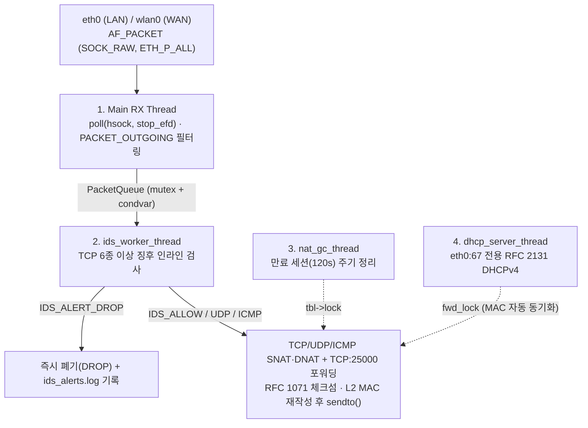

# Embedded L3 NAT Router, Inline IDS & LAN DHCPv4 Gateway

리눅스 커널 IP 포워딩(`net.ipv4.ip_forward = 0`) 없이 **`AF_PACKET` (`SOCK_RAW`)** 으로 L2~L4 패킷을 직접 제어하여, 보호 대상 엣지 서버(NVIDIA Jetson 등)의 모든 인·아웃바운드 통신을 전용 IDS 스레드로 인라인 검사·차단(`DROP`)하고 다중 프로토콜 NAT·정적 포트 포워딩·DHCPv4 주소 할당을 수행하는 C 기반 4-Thread 보안 게이트웨이입니다.

---

## 주요 특징

- **4-Thread 역할 분리 아키텍처 (`POSIX Threads`)**
  1. **Main RX Thread**: `eth0`(LAN) · `wlan0`(WAN) 무차별 수신(`PACKET_MR_PROMISC`), `PACKET_OUTGOING` 루프 필터링 후 링버퍼(`PacketQueue`, 256슬롯) 적재 전담
  2. **`ids_worker_thread`**: 큐 인출 → **TCP 6종 이상 징후 인라인 검사(위협 시 즉시 `DROP` + 감사 로깅) → 통과 패킷에 한해 L3/L4 NAT · 정적 포트 포워딩 · L2 MAC 재작성 송신**
  3. **`nat_gc_thread`**: 10초 주기로 만료된(120초 유휴) NAT 세션 노드를 연결 리스트에서 안전하게 정리(`free`)
  4. **`dhcp_server_thread`**: `SO_BINDTODEVICE`로 LAN 인터페이스(`eth0`)에만 격리된 RFC 2131 DHCPv4 서버(`192.168.100.2 ~ .50` 자동 발급 및 포트 포워딩 대상 MAC 동적 동기화)
- **다중 프로토콜 L3/L4 NAT 및 체크섬 직접 계산 (RFC 1071 / RFC 768)**
  - `TCP`, `UDP`(DNS 53 등 홀수 바이트 페이로드 및 `0xFFFF` 폴백 포함), `ICMP` Echo Request/Reply(`id` 매핑) 지원
  - 리눅스 커널 임시 포트(`32768~60999`)와 충돌하지 않는 전용 NAT 포트 풀(`26000~31000`) 설계
  - 정적 포트 포워딩(`WAN TCP:25000 -> 192.168.100.2:25000`) 및 인입 `peer_mac` 보존으로 동일 대역·외부 클라이언트 모두 직접 응답 지원
- **인라인 TCP IDS (`ids_inspect_tcp`)**
  - 비정상 IP/TCP 헤더 길이(Malformed Header), **LAND Attack**(`srcIP == dstIP`), **TCP NULL Scan**, **TCP Xmas Scan**(`FIN+PSH+URG`), 비정상 플래그 조합(`SYN+FIN`, `SYN+RST`, `FIN+RST`) 즉시 차단
  - 호스트별 5초 슬라이딩 윈도우 기반 **SYN Flood**(50회 초과) 및 **Port Scan**(고유 포트 20개 이상) 탐지·차단 및 `ids_alerts.log` 기록
- **무누수 즉시 종료 (`Async-Signal-Safe`)**
  - `pthread_sigmask`로 시그널 수신 스레드를 고정하고, 핸들러는 async-signal-safe한 `eventfd` `write()`만 수행해 전 스레드를 **0 ms** 내 깨운 뒤 `pthread_join` 완료 후 소켓·로그 FD를 순서대로 회수

---

## 아키텍처 다이어그램



---

## 디렉토리 구성

```text
.
├── header.h               # 패킷 헤더 구조체, NAT/IDS/큐/DHCP 자료구조 및 함수 선언
├── main.c                 # 초기화, 시그널/eventfd 처리, 스레드 기동 및 FD 정리 경로
├── func.c                 # RFC 1071 체크섬, SNAT/DNAT/포트포워딩, IDS, 큐, DHCPv4 구현
├── start_router.sh        # ip_forward=0, ethtool 오프로딩 해제, nftables RST 차단 및 실행 래퍼
├── Makefile               # 빌드(make) 및 통합 검증 스위트 실행(make test)
└── tests/
    └── test_router_ids.c  # 8종 자동 단위·통합 검증 스위트 (NAT/포트포워딩/IDS/DHCP/FD 누수 검사)
```

---

## 빌드 및 테스트

### 1. 컴파일 및 자동 검증 스위트 실행 (root 불필요)

```bash
make
make test
```

`make test`는 아래 8개 항목을 자동으로 검증합니다:
1. TCP 아웃바운드 SNAT ↔ 인바운드 DNAT 왕복 및 체크섬·포트 대역(`26000~31000`) 검증
2. UDP(DNS) 아웃바운드 SNAT ↔ 인바운드 DNAT 왕복 검증
3. ICMP(`ping`) Echo ID 변환 및 체크섬 복원 검증
4. `WAN:25000 ↔ 192.168.100.2:25000` 정적 포트 포워딩 및 `peer_mac` 보존 검증
5. 로컬 관리 IP(`192.168.100.1`)·멀티캐스트·브로드캐스트 WAN 유출 차단 검증
6. 전용 `ids_worker_thread` + `PacketQueue` 경유 6종 공격 인라인 `DROP` 및 로깅 검증
7. 내장 RFC 2131 DHCPv4 (`DISCOVER→OFFER`, `REQUEST→ACK` + 포워딩 MAC 동기화, 타 대역 `NAK`) 검증
8. `eventfd` 시그널 종료 지연(`0 ms`) 및 `/proc/self/fd` 기준 FD 누수 0건 검증

### 2. 실기 게이트웨이 구동 (Linux root 권한 필요)

1. 게이트웨이 LAN 인터페이스(`eth0`)에 `192.168.100.1/24` 부여 (보호 대상 기기는 순정 DHCP 상태 그대로 직결)
2. 실행 스크립트 기동 (`nftables` 커널 `TCP RST` 차단 자동 설정 및 `Ctrl+C` 종료 시 자동 해제):

```bash
sudo ./start_router.sh [lan_if] [wan_if] [fwd_port] [fwd_lan_ip]
# 기본값: sudo ./start_router.sh eth0 wlan0 25000 192.168.100.2
```
